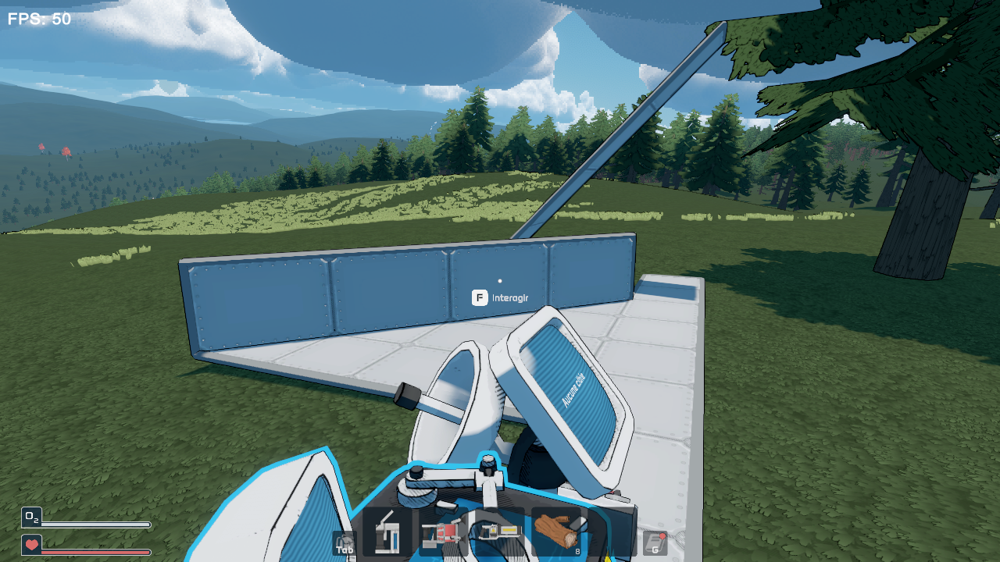

# Build Zoop — StellarDrive mod

Satisfactory-style **zoop** for **StellarDrive (Demo)**, plus everything Build Plus did. A MelonLoader mod built on SDModKit, packaged for [Stellar Mod Manager](https://github.com/jollyname/StellarModManager). It **replaces Build Plus**: remove `BuildPlus.dll`, both patch the build tool.



## Zoop

Hold **Left Shift** with the build tool, aim, **left click**. The first part is the spot under the cursor when Shift goes down; the rest follows your aim, even into empty space, and grows from the first part so every panel touches the previous one.

**Hold V** to open the mode wheel: move the mouse towards a mode and release (right click cancels; the camera does not turn while it is open). A short tap on V still goes to the next mode.

| Mode | What it lays |
| --- | --- |
| **Horizontale** | A flat row along the part's own directions: floors and walls along the axes, **pivoted (diagonal) walls along their diagonal**, slopes along their ramp. Aiming up or down never bends it. |
| **Verticale** | A column straight up or down (stacked walls, floors, pillars). |
| **Diagonale** | A row in any of the 26 directions: **stairs** of floors, diagonal rows of walls, 3D diagonals. |
| **Pyramide** | With a slope corner (lower or upper): one big flat triangle in the corners' sloped plane, lower and upper corners tiling it, one piece narrower on every row. Aim up to narrow it upwards (lower corners along the base), down to narrow it downwards (upper corners along the top). |
| **Zone** (area) | A rectangle in the plane of the first part: floors, walls, **whole diagonal wall surfaces**, slope roofs. Turn off "Zone à plat" for the old 3D box. |
| **Zone diagonale** | The same rectangle turned 45 degrees, from the first part (one corner) to the aim (the opposite one). |
| **Zone diag. + bords** | For flat floors: the 45 degree area with its stepped edges filled with floor corners (flat triangles), so the edges are straight. Other parts behave like Zone diagonale. |

- Slope corners zoop like slopes: rows along the axes, and up their ramps.
- Spots already taken and parts you cannot pay for show in **red** and are skipped (the server does not check either, so nothing gets overwritten). The key tip shows how many parts will be placed and how many lack materials.
- Works with floating parts (step = part size) and with the **recycler** to remove a line, diagonal or area of panels (or a box of floating parts).
- **Backspace** undoes the last zoop (removes what it placed, or puts back what it removed). Up to 30 steps.
- While zooping, the build tool's own preview is hidden: the zoop ghosts show what will be placed.
- Options in the mod menu: hold or toggle the key, flat or 3D areas, max parts per zoop (2000 by default, up to 10000). Big zoops are sent over a few seconds (120 parts per frame) so the server keeps up; the key tip shows what is left to send.

## Two panels in one voxel

Pivoted walls, slopes and slope corners all live in the single "interior" slot of a voxel, so the game refuses a slope corner next to a diagonal wall (although it takes one next to a straight wall), under a slope, or above another corner. Each of these parts is one flat panel cutting its voxel, and two panels can share it as long as they do not cross inside it. Build Zoop adds a second interior slot for such pairs:

- a slope corner along a diagonal wall, on either side;
- a lower slope corner under a slope, an upper one above it;
- an upper slope corner above a lower one.

Aiming at a diagonal wall, a slope or a slope corner with a slope corner (or a slope) in hand snaps the new part into that same voxel, on the side you look from, when it fits there; aiming at the floor next to a diagonal wall does too. Zoop, recycler, paint and pick all work on both parts.

- These second parts are saved in `buildzoop-hull.txt` next to `world.json`, not in `world.json` itself: without the mod the world still loads, those parts are just missing.
- In multiplayer every player needs the mod.

## From Build Plus

- **Middle click pick**: middle click a part to select it in the build tool, with its rotation and its settings (constant value, gate operation, channel, beacon name, lever height).
- **Placement lock**: **K** freezes the preview, arrows and Page Up / Page Down nudge it one cell (or a quarter cell for floating parts), relative to where you look.
- **Rotation lock**: **L**.
- **Circuit copy** (host): Shift + middle click picks floating parts and the cables between them; release Shift and the paste follows the build preview; undo from the menu.

Every key can be rebound in the SDModKit keybinds page.

## Build

```sh
./build.sh          # dist/StellarDrive-BuildZoop.zip (mod.json, Thumbnail.png, Mods/BuildZoop.dll)
./dev.sh            # DEV build: deploys, starts the game on the BZ_Test world
./cmd.sh "zoop 7 1 3 0 0 Floor Up Forward Line 8 -0.5 0"   # dev commands, see src/Dev/DevHarness.cs
```

The project references the game, MelonLoader and SDModKit from the default Steam install (`-p:GamePath=...` to change it).
